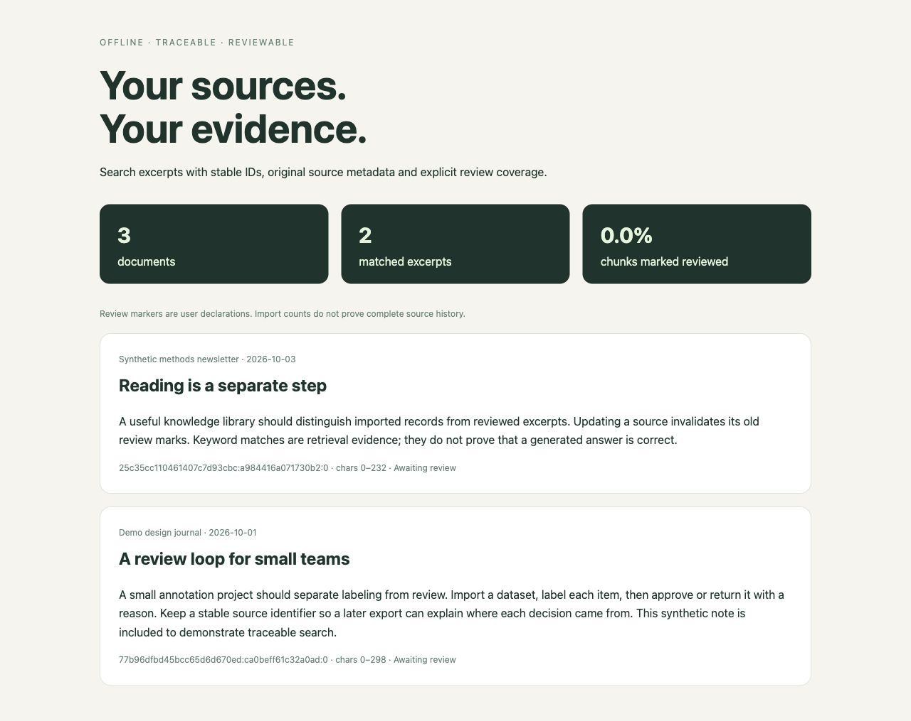
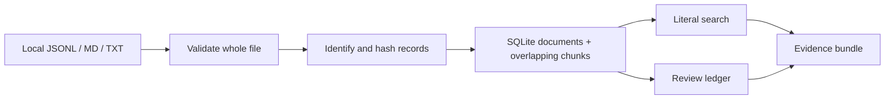

<div align="center">

# Source Ledger

**Search your sources. Keep the evidence. Know what you have reviewed.**

[中文](README.zh-CN.md) · [Quick start](#quick-start) · [Input format](docs/input-format.md) · [Design](docs/design.md)

[](https://github.com/608tt/source-ledger/actions/workflows/test.yml)

[](LICENSE)

</div>

Source Ledger turns local articles, chat exports, notes and transcripts into a
searchable SQLite library. Every excerpt includes its source, stable ID,
character offsets and content hash. A separate review ledger distinguishes
**imported**, **matched** and **marked reviewed** material.



## What you get

- **Offline core:** Python's standard library; no account, API key or network calls.
- **Chinese and English search:** literal multi-term matching with source filters.
- **Safe repeat imports:** stable IDs preserve distinct chat messages and skip unchanged records.
- **Revision-aware review:** changing a record clears its old chunk review marks.
- **Traceable excerpts:** source/title/date/URL, SHA-256 and zero-based character offsets.
- **Portable bundles:** export matching excerpts as Markdown, JSON or a readable standalone HTML page.
- **Honest coverage:** imported counts and review markers never claim that a source's history is complete.
- **Optional MCP adapter:** let an AI assistant search a chosen vault through three read-only local tools.

## Quick start

Requires Python 3.10+. Run directly from a clone; installation is optional.

```bash
git clone https://github.com/608tt/source-ledger.git
cd source-ledger
python -m source_ledger import examples/demo.jsonl
python -m source_ledger search review
python -m source_ledger search 项目
python -m source_ledger status
python -m source_ledger export review --format html --output evidence.html
```

Open `evidence.html` in your browser. All demo inputs are synthetic.
For an installed command: `pip install .`, then use `source-ledger`.

### Import your own notes

```bash
python -m source_ledger import notes.md --kind note --source "Design journal"
python -m source_ledger --root ./my-vault search "review dataset"
```

The default vault is `.source-ledger` in the current directory. Place `--root`
**before** the subcommand. Use the same root for import and subsequent searches.

### Review an excerpt

```bash
python -m source_ledger pending
python -m source_ledger read CHUNK_ID
python -m source_ledger review CHUNK_ID --note "Checked against the source; summary is accurate."
```

Replace `CHUNK_ID` with the ID returned by `pending`. A review marker records
your declaration; the tool cannot verify that a person read or understood it.

## Input format

JSONL: one object per line. Supported kinds are `article`, `chat`, `note` and
`transcript`; `source` and non-empty `text` are required.

```json
{"id":"note-01","kind":"note","source":"My notebook","title":"Review workflow","date":"2026-10-01","text":"Keep a source ID with every excerpt."}
```

Use a stable original `id` for repeat imports. Markdown and TXT imports accept
`--kind` and `--source`. See [format details](docs/input-format.md) for updates,
chunking and duplicates.

## How it works



Search uses parameterized SQLite queries. English case matching follows
SQLite's built-in ASCII lowercase behavior; Chinese matches literal characters.
Chunking uses 1,600 characters with 120-character overlap by default.

## Connect an AI assistant

The CLI remains dependency-free. The optional adapter uses the official MCP
Python SDK and serves an existing vault over local stdio:

```bash
pip install ".[mcp]"
source-ledger-mcp --root /absolute/path/to/my-vault
```

It exposes `search_sources`, `read_excerpt` and `get_coverage`. Searches return
versioned IDs, source metadata, content hashes and bounded excerpts. The server
opens SQLite read-only and provides no import, delete or mark-reviewed tool.
A model reading an excerpt does not count as a person's review.

See [MCP setup](docs/mcp.md) for a client configuration and a synthetic example.
When connected to an AI host, returned text can enter that host's model context;
choose the vault accordingly. The server itself makes no network requests.

## Tests and boundaries

```bash
python -m unittest discover -s tests -v
```

14 core tests cover atomic validation, moved-file deduplication, repeated chat IDs,
revision invalidation, stale excerpt IDs, metadata updates, offsets, Chinese
search, HTML escaping and CLI errors.
Local validation used Python 3.14.7; the CI matrix targets 3.12/3.13.
See the [validation record](docs/validation.md) for installation checks.
With the MCP extra installed, six additional tests cover protocol calls,
read-only access, bounded results and an actual stdio subprocess: **20 total**.

This is a source-management tool. It does not generate answers, scrape websites,
decrypt chat databases or build embeddings. Literal search can miss synonyms
and matches spanning more than the configured overlap. Deleted source records
are not automatically removed. See [design and limits](docs/design.md).

The project grew from the author's local article/chat knowledge-library script.
Only generic code and synthetic examples are included. MIT licensed;
[contributions](CONTRIBUTING.md) are welcome.
